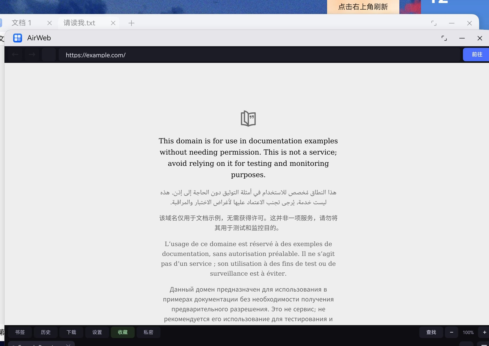
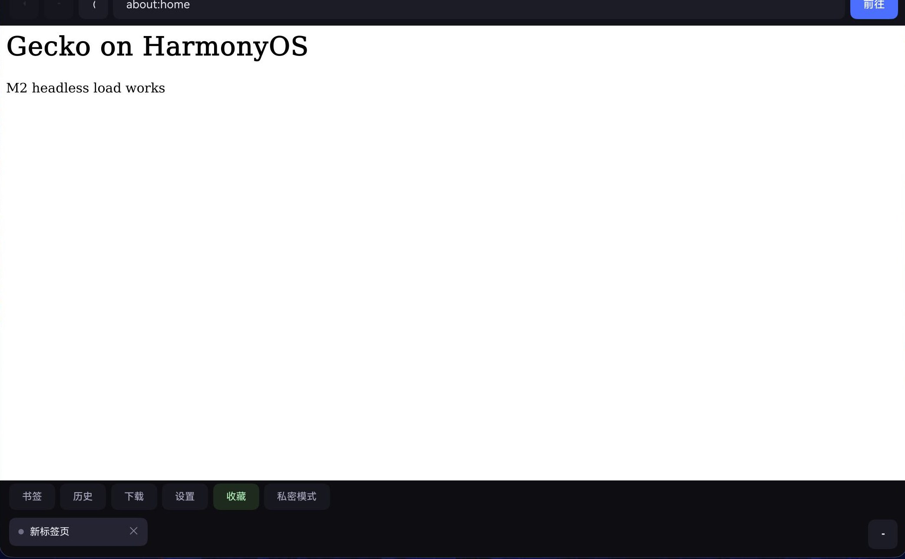
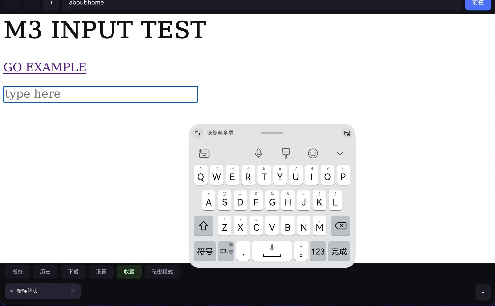
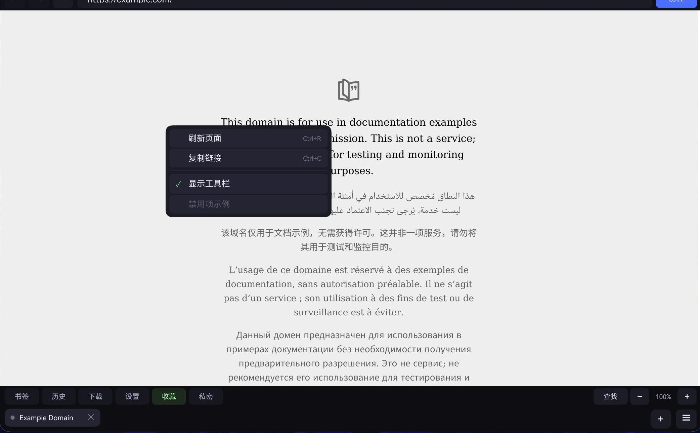
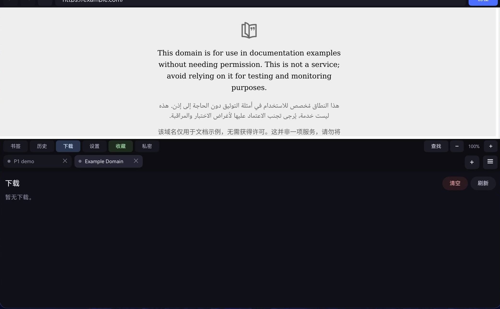
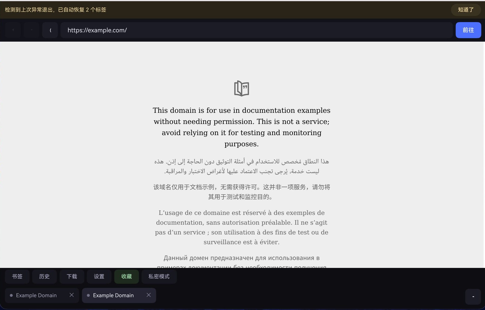

<div align="center">

# AirWeb

**把 Gecko 内核装进鸿蒙平板的独立浏览器 —— ArkTS 外壳 + 可复现的内核移植补丁**

Gecko 142 (mozilla-central `5836a062`) · HarmonyOS 7 / API 26 · arm64-v8a · DevEco Studio 5/6 · MPL-2.0



</div>

> **English TL;DR** — AirWeb is an independent, Gecko-based browser for HarmonyOS / OpenHarmony
> arm64. The engine (`libxul.so`, Firefox 142 branch) is cross-compiled in WSL with the OHOS NDK;
> an ArkTS shell drives it through a NAPI bridge and renders into an `XComponent`. It browses the
> real web, handles IME and touch, manages tabs/downloads/history, survives crashes with session
> recovery, and squeezes the install down to 250 MB. Engine binaries live in
> [Releases](releases); the exact engine tree is reproduced by one patch in [`engine/`](engine/).
> Renamed from “Firefox for HarmonyOS” for Mozilla trademark compliance — no affiliation with Mozilla.

> **关于名字**：本项目原名 “Firefox for HarmonyOS”，2026-11-18 按 P4 合规要求更名为 **AirWeb**：
> 应用名、窗口标题、界面文案不再使用 Firefox 品牌，只保留“基于 Gecko 142”这一事实描述。
> GitHub 仓库地址沿用 `firefox-ohos` 作为历史链接。技术上完全是同一套 Gecko 内核 + OHOS 移植层。

---

## 这是什么

一台 HarmonyOS 平板（HUAWEI MatePad Edge QXS-W00，HarmonyOS 7.0.0.111 / API 26）上跑着真正的
Gecko 浏览器内核：不是 ArkTS 里套 `Web` 组件，而是把 Firefox 的 `libxul.so` 交叉编译到
`aarch64-linux-ohos`，用 NAPI 桥接给 ArkTS，WebRender 直接渲染到 XComponent 的 Surface。

它已经能日常浏览：开网页、点链接、开新标签、输网址（带历史/书签补全）、弹输入法、下载并管理文件、
保存图片、页内查找、缩放、全屏，崩溃后自动恢复标签。**它不是完整 Firefox**——没有扩展商店、
没有 Sync、没有多进程隔离，是单进程、单 Surface 的嵌入式内核实现。

## 现在能跑什么（全部真机验证）

| 能力 | 状态 | 证据 |
|---|---|---|
| 引擎启动（profile / prefs / XPCOM / chrome） | ✅ | `XRE_main` 全链路日志 |
| 首帧渲染（XComponent → OHNativeWindow → EGL → WebRender） | ✅ |  |
| 触摸 / 鼠标 / 键盘 → APZ → DOM | ✅ | `[OHOS_ACT] DispatchClickEvents` 命中元素 |
| 输入法（Gecko 输入框 ↔ 系统键盘） | ✅ |  |
| 真实网络（HTTPS + INTERNET 权限） | ✅ | example.com 加载渲染 |
| 紧凑界面：地址栏单行 + 底栏三行压两行 | ✅ |  |
| 原生菜单浮层（XUL popup → ArkTS，含子菜单/勾选/快捷键） | ✅ UI 通路 |  |
| 链接“在新标签页打开”、保存图片、复制图片/页面地址 | ✅ | P2-2 真机日志 |
| 下载管理：记录落库、打开、清空（删文件） | ✅ |  |
| 历史（引擎驱动）+ 地址栏自动补全 | ✅ | 输入 `exa` → 下拉 `https://example.com/` |
| 页内查找 / 缩放 / 全屏 | ✅ |  |
| 崩溃/force-stop 后会话恢复（横幅含上次 URL） | ✅ |  |
| 长稳压测：15 轮启停+标签+导航+关标签 | ✅ 0 崩溃 | RSS 298–317 MB，无单调增长 |
| SpiderMonkey JIT（需 ACL 签名） | ✅ | 计算密集场景 **14–38×** |

<details>
<summary><b>JIT vs 解释器：真机基准（点开看数据）</b></summary>

| 基准 | JIT | 解释器 | 变化 |
|---|---|---|---|
| `fib(27)` 递归 | 3 ms | 114 ms | **≈38×** |
| 对象属性累加 5,000,000 次 | 34 ms | 496 ms | **≈14.6×** |
| 数组 `map`+`reduce` 1,000,000 | 44 ms | 648 ms | **≈14.7×** |
| 冷启动 engine start → 首帧 | 401 ms | 372 ms | +29 ms |

JIT 需要带 ACL 的签名 profile（两条 `ohos.permission.kernel.*`）+ `libxul.so` 的 `.permission`
ELF 段；没有 ACL 时引擎自动降级解释器。详见 [性能基线报告](docs/Firefox移植-性能基线报告.md)。

</details>

## 体积（P2-3）

| 项 | v1.0 | v1.1 | 说明 |
|---|---|---|---|
| gecko libs | 302 MB | **213 MB** | `llvm-strip --strip-unneeded` 全量瘦身 |
| `omni.ja` | 65.5 MB (STORED) | **20.4 MB** (deflate -6) | Omnijar 支持 deflate，实测可正常加载 |
| HSP 安装包 | 292.3 MB | **250.2 MB**（-14.4%） | 真机安装/启动/加载正常 |
| 冷启动首帧 | 5890 ms | 5858 ms | 无退化（差异在噪声内） |

> 冲 ≤200 MB 的 v2 尝试（`-Os` + `--disable-webrtc` 等）因该分支 ipdl/bindgen 兼容问题**已回退**，
> 记录见 [P2-3 文档](docs/Firefox移植-P2-3体积与性能.md)。当前产物即 v1 的 250.2 MB 构建。

## 工程化（P3）

日常四步全部收敛成脚本，任何一步失败都会返回非 0：

```powershell
powershell -File scripts/build-all.ps1        # 构建 HSP+HAP，打印体积
powershell -File scripts/verify-snapshot.ps1  # 体积预算 / .permission / omni 内容 / ACL / CRLF
powershell -File scripts/install-device.ps1 -Reinstall
powershell -File scripts/smoke-test.ps1       # 首帧 / 页面 / 右键菜单 / 进程存活
powershell -File scripts/soak-test.ps1 -Cycles 8
```

`scripts/ci/run-local.ps1` 把 build → verify → smoke 串成一条本地 CI，实测全 PASS：

```
PASS  HSP size budget 250.2 MB <= 270 MB
PASS  libxul .permission section
PASS  omni geckoview.js context menu
PASS  ACL: writable code memory
PASS  first-composite / page loaded / context menu shown / process alive
CI LOCAL: PASS
```

历史一次性 patch 已归档到 `scripts/archive/`（175 个），**当前源码即权威状态，勿重放**。

## 架构

```
┌──────────────────────────────────────────────────────────────┐
│ DevEco 工程 (API 26, arm64-v8a)                               │
│                                                              │
│  entry/  (ArkTS HAP)                                         │
│   ├─ EntryAbility     启动、参数、会话标记、菜单回调           │
│   ├─ BrowserPage      地址栏/标签/下载横幅/错误页/菜单浮层     │
│   ├─ GeckoSurface     XComponent + 事件 + IME 隐藏输入框      │
│   └─ SessionStore     session.json 防抖落盘 + 异常退出检测     │
│                                                              │
│  gecko/  (HSP 共享包)                                        │
│   ├─ GeckoViewBoot.ets 首帧 / URL / 标题 / 下载 / Picker 回调 │
│   ├─ libgecko_napi.so  NAPI 桥（cpp/，CMake 构建）            │
│   ├─ libxul.so         Gecko 主库（JIT 版，带 .permission）   │
│   ├─ libgeckoview.so   OHOS 平台层（widget/openharmony）      │
│   └─ rawfile/omni.ja   GRE 资源（deflate，20 MB）             │
└──────────────────────────────────────────────────────────────┘
        │ NAPI / TSFN                  ▲ XUL 菜单 JSON
        ▼                              │
┌──────────────────────────────────────────────────────────────┐
│ Gecko 142 (mozilla-central 5836a062) + OHOS 移植层            │
│  widget/openharmony   nsAppShell / nsWindow / OHOSNativeWindow│
│  ports/ohos           NAPI 宿主、输入、IME、下载、菜单桥       │
│  gfx/                 RenderCompositorEGL、gfxOHosPlatform     │
│  layout/              移动视口、paint holding、popup 抑制      │
│  browser/             geckoview.js 菜单构造、chrome 桥         │
└──────────────────────────────────────────────────────────────┘
```

## 仓库结构

```
airweb/  (repo: firefox-ohos)
├─ app/                  DevEco 工程（entry HAP + gecko HSP）
│  ├─ entry/src/main/ets/    ArkTS 外壳（BrowserPage/AddressBar/TabBar/Downloads…）
│  ├─ entry/src/main/resources/rawfile/legal/   随包许可：MPL 全文、第三方清单、Source Offer
│  ├─ gecko/src/main/{ets,cpp}/                  引擎门面、NAPI 桥
│  ├─ spec/                                      立项 / 风险 / 安全合规
│  └─ build-profile.json5                        已脱敏：签名请在本机生成
├─ engine/               Gecko 侧
│  ├─ patches/firefox-ohos-gecko-5836a06272.patch    整树补丁（5.6 MB / 1128 文件）
│  ├─ mozconfig                                    交叉编译配置
│  ├─ apply-port.sh                                一键打补丁
│  └─ PROVENANCE.md                                来源、基线与社区移植层关系
├─ scripts/              P3 流水线：build / verify / install / smoke / soak / ci + archive
├─ docs/                 技术文档（体检、P0–P4、性能、合规、两轮审视）
├─ evidence/             真机截图
└─ dist-assets/          Release 附件的安装脚本与说明
```

## 快速上手

### 路线 A：用现成引擎产物（约 10 分钟）

1. 到 [Releases](releases) 下载 `airweb-engine-1.1.0.zip`（约 180 MB）。
2. 装好 **DevEco Studio**（HarmonyOS SDK **API 26**）与 `hdc`。
3. 铺引擎：

   ```powershell
   powershell -ExecutionPolicy Bypass -File .\install.ps1 -AppPath D:\path\to\app
   ```

4. DevEco 打开 `app/`，`File > Project Structure > Signing Configs` 勾选自动签名。
5. 构建并安装：

   ```bash
   cd app
   hvigorw assembleHsp assembleHap --no-daemon

   hdc shell "bm uninstall -n com.example.firefoxport"   # 改过 HSP 必须卸载重装
   hdc file send entry/build/default/outputs/default/entry-default-signed.hap /data/local/tmp/entry.hap
   hdc file send gecko/build/default/outputs/default/gecko-default-signed.hsp  /data/local/tmp/gecko.hsp
   hdc shell "bm install -p /data/local/tmp/entry.hap /data/local/tmp/gecko.hsp"
   ```

### 路线 B：从源码重建内核（约 4–6 小时）

```bash
git clone --filter=blob:none --no-checkout https://gitee.com/mirrors/gecko-dev.git gecko
cd gecko
git fetch --depth 1 origin 5836a062726f715fda621338a17b51aff30d0a8c
git checkout 5836a062726f715fda621338a17b51aff30d0a8c
git apply -p1 /path/to/engine/patches/firefox-ohos-gecko-5836a06272.patch

cp /path/to/engine/mozconfig ./mozconfig
export OHOS_SDK_NATIVE=/opt/ohos-sdk/native
./mach build -j$(nproc)

bash /path/to/scripts/stage-engine.sh
```

补丁可复现性：在纯净 `5836a062` 检出上应用后逐字节比对 **1128 个文件，0 差异**。
重建 `omni.ja` 时注意用 **deflate**（`zip -6`），默认 `build-omni.sh` 仍是 STORED。

## 三个绕不过去的坑

### 1. 签名：普通证书能装，但 JIT 要 ACL

`module.json5` 声明了两条内核权限（ACL）：`ALLOW_WRITABLE_CODE_MEMORY`、
`DISABLE_CODE_MEMORY_PROTECTION`。用 IDE 自动签名可正常安装运行，但引擎会检测到 RWX 不可执行并
**自动降级为解释器**（JS 慢 14–38 倍）。JIT 生效还需给 `libxul.so` 注入 `.permission` 段：

```bash
llvm-objcopy --add-section .permission=ports/ohos/permission.json \
             --set-section-flags .permission=readonly libxul.so
```

### 2. 改了 HSP 一定要卸载重装

`bm install -r` 在 HSP 版本号不变时会保留旧副本，表现为新方法在 ArkTS 里是 `undefined`。
用 `scripts/install-device.ps1 -Reinstall` 或先 `bm uninstall`。

### 3. `omni.ja` 不是普通压缩包

它是 mozjar 生成的 GRE 资源包，必须整体放进 `rawfile/`，运行时复制到沙箱再以目录形式传给
`-greomni`。v1.1 起改用 deflate（20 MB），别手工解压或重打包成 STORED。

## 合规与品牌（P4）

| 项 | 处理 |
|---|---|
| 应用名 / 界面 | **AirWeb**；不再出现 Firefox 品牌；不使用 Mozilla Logo |
| 许可 | MPL-2.0；修改过的 Gecko 文件保留 MPL 头 |
| 随包材料 | `legal/LICENSE-MPL-2.0.txt`、`THIRD-PARTY-NOTICES.txt`、`SOURCE-OFFER.txt` |
| 源码获取 | [SOURCE-OFFER.md](docs/SOURCE-OFFER.md) + 本仓库 `engine/` 补丁 |
| LGPL 组件 | FFmpeg / libvpx 动态库链接，未改源码 |
| 隐私 | 无遥测、无自动崩溃上传；历史/书签/下载仅存本机 |

正式发布前仍需：自有签名证书与 Profile、包名改为自有反写域名、第三方许可法务复核。

## 已知限制

- 单进程、无 e10s、无崩溃隔离；`force-stop` 一律视为异常退出（启动时提示恢复）。
- **真实右键/长按菜单尚未接通**：菜单桥与浮层 UI 已验证（合成负载），但 classic 轨道下内容区
  context menu 没有进入 `OHOSMenuBridge_ShowContextMenu`，见 P1.5 文档。
- 会话恢复只恢复 URL，不恢复滚动位置/表单内容/历史栈。
- 下载只落应用沙箱；「打开」按扩展名映射 mime，系统无对应查看器时（如 SVG）打不开。
- 地址栏补全在部分场景会被系统窗口抢焦点（已可用，未完全稳定）。
- 2in1 窗口形态下无法真正全屏，全屏 = 隐藏外壳 + 尽力隐藏系统栏。
- 无 minidump：崩溃取证靠 hilog + 宿主脚本抓取，`faultloggerd` 需要系统权限。

## 路线图

| 阶段 | 内容 | 状态 |
|---|---|---|
| M0–M3 | 骨架 / SpiderMonkey / headless / 首帧+输入+IME+网络 | ✅ |
| P0–P1 | 崩溃恢复、看门狗；下载、Picker、全屏、查找、缩放 | ✅ |
| P1.5 | 紧凑界面、原生菜单浮层 | ✅（真实菜单事件待接） |
| P2-1 | 长稳 15 轮 0 崩溃、崩溃现场记录 | ✅ |
| P2-2 | 新标签打开、保存图片、下载管理、历史/补全 | ✅ |
| P2-3 | 体积 292→250 MB | ✅（≤200 MB 待引擎裁剪） |
| P3 | 一键脚本 + 快照校验 + 本地 CI | ✅ |
| P4 | 品牌、许可、权限、分发合规 v1 | ✅ |
| 下一阶段 | 真实右键菜单、≤200 MB、发布签名、扩展 UI | ⬜ |

## 文档

- [环境体检报告（API 26）](docs/Firefox-HarmonyOS-API26-移植环境体检报告.md)
- [项目审视（第二轮）](docs/Firefox移植-项目审视（第二轮）.md) · [第一轮](docs/Firefox移植-项目审视与下一步计划.md)
- 阶段记录：[P0](docs/Firefox移植-P0稳定性说明.md) · [P1](docs/Firefox移植-P1可用性说明.md) ·
  [P1.5](docs/Firefox移植-P1.5菜单与界面压缩.md) · [P2-1](docs/Firefox移植-P2-1稳定性长稳与崩溃上报.md) ·
  [P2-2](docs/Firefox移植-P2-2浏览器壳完善.md) · [P2-3](docs/Firefox移植-P2-3体积与性能.md) ·
  [P3](docs/Firefox移植-P3工程化.md) · [P4](docs/Firefox移植-P4合规与分发.md)
- [性能基线（JIT vs 解释器）](docs/Firefox移植-性能基线报告.md)
- 合规：[SOURCE-OFFER](docs/SOURCE-OFFER.md) · [THIRD-PARTY-NOTICES](docs/THIRD-PARTY-NOTICES.md)
- 工程规范：[spec/](app/spec/gecko-porting-program/)（决策包、风险登记、安全合规、上游维护）

## 为什么二进制不在 Git 里

GitHub 单文件硬上限 100 MB，而 `libxul.so` 185 MB、`omni.ja` 20 MB、HSP 250 MB。
Git LFS 免费额度 1 GB 存储 / 1 GB 月流量，一次克隆就会耗掉大半。所以：

- **代码 / 补丁 / 文档** → Git（仓库约 15 MB）
- **内核二进制** → [Releases](releases)（带 `SHA256SUMS`）
- **构建树 / 日志 / 签名材料** → 不入库（`.gitignore` 已兜底）

## 许可与归属

- 本仓库代码与补丁：**MPL-2.0**（与 Gecko 一致）。
- Gecko / SpiderMonkey / Firefox：Mozilla Foundation，MPL-2.0。
- OHOS 平台适配层参考并基于社区项目
  [`ohos_gecko-opensource`](https://gitcode.com/OpenHarmonyPCDeveloper/ohos_gecko-opensource)（MPL-2.0），
  来源与差异见 [engine/PROVENANCE.md](engine/PROVENANCE.md)。
- “Firefox”“Gecko” 是 Mozilla Foundation 的商标。**AirWeb 与 Mozilla 无隶属、赞助或背书关系**，
  仅在技术事实层面说明“基于 Gecko 142”；不发布 Mozilla 品牌资源。
- 第三方组件清单见 [NOTICE](NOTICE) 与 [THIRD-PARTY-NOTICES](docs/THIRD-PARTY-NOTICES.md)。

---

<div align="center">
<sub>WSL + OHOS NDK 交叉编译，在平板上真正跑起来的内核移植 · 2026-11-18 · v1.1.0</sub>
</div>
