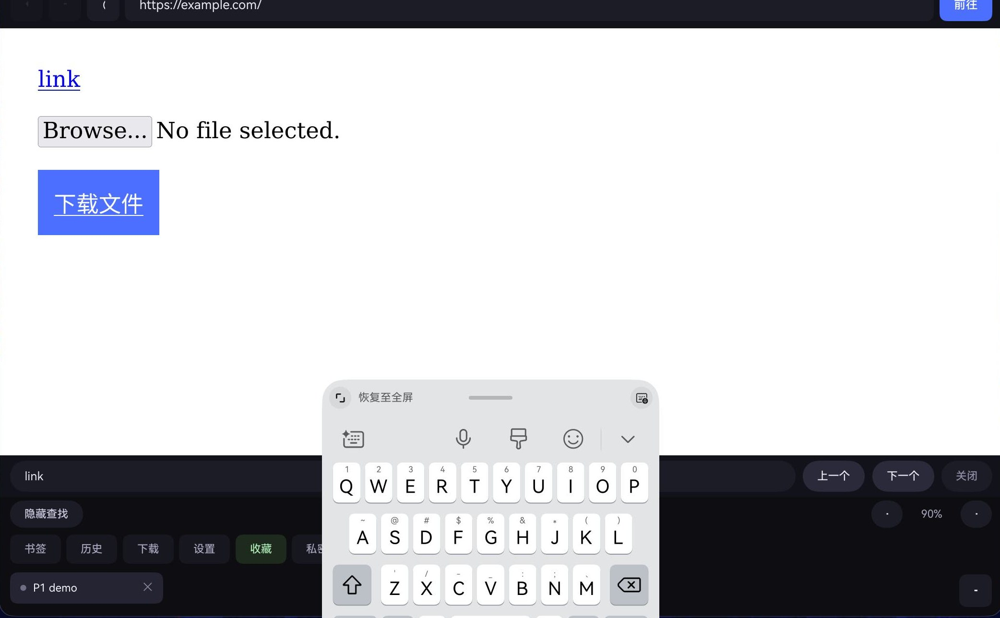

<div align="center">

# Firefox for HarmonyOS

**把 Gecko 内核塞进鸿蒙平板：一个能真实上网的 ArkTS 浏览器外壳 + 一份可复现的内核移植补丁**

Gecko 142 (mozilla-central `5836a062`) · HarmonyOS 7 / API 26 · arm64-v8a · DevEco Studio 5/6


</div>

> **English TL;DR** — This is a from-scratch port of the Gecko engine (Firefox 142 branch) to
> HarmonyOS/OpenHarmony arm64, plus an ArkTS browser shell (tabs, address bar, IME, downloads,
> find-in-page, session recovery). Gecko is cross-compiled in WSL Ubuntu with the OHOS NDK;
> the shell talks to it through a NAPI bridge and renders into an `XComponent`. The engine
> binaries are too large for Git, so they live in [Releases](releases); the exact source
> tree is reproduced by one patch in [`engine/`](engine/). License: MPL-2.0.

---

## 这是什么

一台 HarmonyOS 平板（HUAWEI MatePad Edge QXS-W00，HarmonyOS 7.0.0.111 / API 26）上，跑着一个
真正的 Gecko 浏览器内核：不是在 ArkTS 里套个 `Web` 组件，而是把 Firefox 的 `libxul.so` 交叉编译到
`aarch64-linux-ohos`，用 NAPI 桥接给 ArkTS，WebRender 直接渲染到 XComponent 的 Surface 上。

它已经能：打开网页、点链接、输网址、弹输入法打字、切标签、下载文件、页内查找、缩放、全屏，
以及崩溃后自动恢复标签。**它不是完整的 Firefox 桌面版**——没有扩展商店、没有 Sync、没有多进程隔离，
是一个单进程、单 Surface 的嵌入式内核参考实现。

## 现在能跑什么（真机验证）

| 能力 | 状态 | 证据 |
|---|---|---|
| 引擎启动（profile / prefs / XPCOM / chrome 注册） | ✅ | `XRE_main` 全链路日志 |
| 首帧渲染（XComponent → OHNativeWindow → EGL → WebRender） | ✅ |  |
| 触摸 / 鼠标 / 键盘事件 → APZ → DOM | ✅ | `[OHOS_ACT] DispatchClickEvents` 命中元素 |
| 输入法（Gecko 输入框 ↔ 系统键盘） | ✅ |  |
| 真实网络（HTTPS，INTERNET 权限） | ✅ | example.com 加载并渲染 |
| 地址栏 / 标题 / 标签 ↔ 引擎会话双向同步 | ✅ | 截图中的双标签 |
| 崩溃 / force-stop 后会话恢复 | ✅ |  |
| 加载超时 20s 看门狗 + 错误页 | ✅ | `load watchdog fired` |
| 下载 / 文件选择 / 全屏 / 页内查找 / 缩放 | ✅ |  |
| SpiderMonkey JIT（需 ACL 签名） | ✅ | 计算密集场景 **14–38×** 加速 |

<details>
<summary><b>JIT vs 解释器：真机基准（点开看数据）</b></summary>

| 基准 | JIT | 解释器 | 变化 |
|---|---|---|---|
| `fib(27)` 递归 | 3 ms | 114 ms | **≈38×** |
| 对象属性累加 5,000,000 次 | 34 ms | 496 ms | **≈14.6×** |
| 数组 `map`+`reduce` 1,000,000 | 44 ms | 648 ms | **≈14.7×** |
| 冷启动 engine start → 首帧 | 401 ms | 372 ms | +29 ms |

JIT 需要带 ACL 的签名 profile（两条 `ohos.permission.kernel.*` 内核权限）+ 给 `libxul.so`
注入 `.permission` ELF 段；没有 ACL 时引擎会自动降级到解释器。详见
[性能基线报告](docs/Firefox移植-性能基线报告.md)。

</details>

## 架构

```
┌──────────────────────────────────────────────────────────────┐
│ DevEco 工程 (API 26, arm64-v8a)                               │
│                                                              │
│  entry/  (ArkTS HAP)                                         │
│   ├─ EntryAbility     启动、命令行参数、会话标记              │
│   ├─ BrowserPage      地址栏 / 标签 / 下载横幅 / 错误页       │
│   ├─ GeckoSurface     XComponent + 事件 + IME 隐藏输入框      │
│   └─ SessionStore     session.json 防抖落盘 + 异常退出检测     │
│                                                              │
│  gecko/  (HSP 共享包)                                        │
│   ├─ GeckoEngine.ets  ArkTS 会话 API 门面                    │
│   ├─ GeckoViewBoot.ets 首帧 / URL / 标题 / 下载 / Picker 回调 │
│   ├─ libgecko_napi.so NAPI 桥（cpp/，CMake 构建）             │
│   ├─ libxul.so        Gecko 主库（JIT 版，带 .permission）    │
│   ├─ libgeckoview.so  OHOS 平台层（widget/openharmony）       │
│   └─ rawfile/omni.ja  GRE 资源（chrome、JS 组件、默认页面）    │
└──────────────────────────────────────────────────────────────┘
                    │  NAPI / TSFN 回调
                    ▼
┌──────────────────────────────────────────────────────────────┐
│ Gecko 142 (mozilla-central 5836a062) + OHOS 移植层            │
│  widget/openharmony   nsAppShell / nsWindow / OHOSNativeWindow │
│  ports/ohos           NAPI 宿主、输入、IME、下载、菜单         │
│  gfx/                 RenderCompositorEGL、gfxOHosPlatform     │
│  layout/              移动视口、paint holding、popup 抑制      │
│  browser/             ohos-chrome-bridge.js、phone-chrome     │
└──────────────────────────────────────────────────────────────┘
```

## 仓库结构

```
firefox-ohos/
├─ app/                  DevEco 工程（entry HAP + gecko HSP）
│  ├─ entry/src/main/ets/    ArkTS 外壳源码
│  ├─ gecko/src/main/ets/    引擎门面与回调
│  ├─ gecko/src/main/cpp/    NAPI 桥（CMake）
│  ├─ spec/                  立项 / 风险 / 安全合规等工程文档
│  └─ build-profile.json5    已脱敏：签名请在本机生成
├─ engine/               Gecko 侧
│  ├─ patches/firefox-ohos-gecko-5836a06272.patch    整树补丁（5.6 MB）
│  ├─ mozconfig                                    交叉编译配置
│  ├─ apply-port.sh                                 一键打补丁
│  └─ PROVENANCE.md                                 来源、基线与与社区移植层的关系
├─ scripts/              构建 / 基准 / 历史探针脚本（UTF-8 化）
├─ docs/                 中文技术文档（环境体检、P0/P1、性能、路线图）
├─ evidence/             真机截图
└─ dist-assets/          Release 附件的安装脚本与说明
```

## 快速上手

### 路线 A：用现成引擎产物（推荐，约 10 分钟）

1. 到 [Releases](releases) 下载 `firefox-ohos-engine-1.0.0.zip`。
2. 装好 **DevEco Studio**（含 HarmonyOS SDK **API 26**）与 `hdc`。
3. 把引擎铺到工程里：

   ```powershell
   powershell -ExecutionPolicy Bypass -File .\install.ps1 -AppPath D:\path\to\firefox-ohos\app
   ```

4. DevEco 打开 `app/`，`File > Project Structure > Signing Configs` 勾选自动签名。
5. 构建：

   ```bash
   hvigorw assembleHsp assembleHap --no-daemon
   ```

6. 安装到设备（**改了 HSP 必须卸载重装**，见下方“坑”）：

   ```bash
   hdc shell "bm uninstall -n com.example.firefoxport"
   hdc file send entry/build/default/outputs/default/entry-default-signed.hap /data/local/tmp/entry.hap
   hdc file send gecko/build/default/outputs/default/gecko-default-signed.hsp  /data/local/tmp/gecko.hsp
   hdc shell "bm install -p /data/local/tmp/entry.hap /data/local/tmp/gecko.hsp"
   ```

### 路线 B：从源码重建内核（约 4–6 小时）

环境：WSL2 Ubuntu 24.04 + OpenHarmony 7 native SDK（`/opt/ohos-sdk/native`）+ Rust stable + clang。

```bash
# 1) 取上游，pin 到我们验证过的提交（只取这一个提交，仓库约 1 GB）
git clone --filter=blob:none --no-checkout https://gitee.com/mirrors/gecko-dev.git gecko
cd gecko && git fetch --depth 1 origin 5836a062726f715fda621338a17b51aff30d0a8c
git checkout 5836a062726f715fda621338a17b51aff30d0a8c

# 2) 打上本仓库的内核移植补丁
git apply -p1 /path/to/firefox-ohos/engine/patches/firefox-ohos-gecko-5836a06272.patch

# 3) 交叉编译（mozconfig 见 engine/mozconfig）
cp /path/to/firefox-ohos/engine/mozconfig ./mozconfig
./mach build -j$(nproc)

# 4) 把产物铺回 App 工程
bash /path/to/firefox-ohos/scripts/build/stage-engine.sh
```

补丁的**可复现性**：我们在纯净的 `5836a062` 检出上应用它，逐字节比对了 1128 个文件，
差异为 0。详见 [engine/README.md](engine/README.md)。

## 两个绕不过去的坑

### 1. 签名：普通证书能装，但 JIT 要 ACL

`module.json5` 里声明了两条内核权限：

```json
{ "name": "ohos.permission.kernel.ALLOW_WRITABLE_CODE_MEMORY" },
{ "name": "ohos.permission.kernel.DISABLE_CODE_MEMORY_PROTECTION" }
```

它们属于 **ACL 权限**，只有 **带 ACL 的签名 profile** 才能授予（需要 AGC 申请、注册设备 UDID）。
用 IDE 自动签名生成的调试证书可以正常安装运行，但引擎会检测到 RWX 不可执行并**自动降级为解释器**。
换句话说：不折腾签名也能把浏览器跑起来，只是 JS 慢 14–38 倍。

另外，`libxul.so` 需要 `.permission` ELF 段：

```bash
llvm-objcopy --add-section .permission=ports/ohos/permission.json \
             --set-section-flags .permission=readonly libxul.so
```

### 2. 改了 HSP 一定要卸载重装

`bm install -r` 在 HSP 版本号不变时会保留旧副本，导致你改了 `GeckoViewBoot` 但设备还跑旧代码
（表现为新方法在 ArkTS 里是 `undefined`）。约定：**改 gecko 模块后 `bm uninstall` 再装**，或提升 `versionCode`。

## 已知限制

- 单进程、无 e10s、无崩溃隔离；`force-stop` 一律视为异常退出（下次启动会提示恢复）。
- 会话恢复只恢复 URL，不恢复滚动位置 / 表单内容 / 历史栈。
- 下载只落到应用沙箱 `Downloads/`，没有“另存为”与完成通知；Picker 复制到缓存的文件暂无淘汰策略。
- 2in1 窗口形态下系统栏无法真正全屏，全屏是“隐藏浏览器外壳 + 尽力隐藏系统栏”。
- 页内查找无命中计数/高亮统计；菜单 / 右键菜单尚未接入（需抑制 XUL popup 浮层）。
- 无 minidump 自动上报；崩溃分析仍靠 hilog + 符号化脚本。
- 扩展：AMO 安装链路已适配（`AddonManager`），但未做完整商店 UI。

## 路线图

| 阶段 | 内容 | 状态 |
|---|---|---|
| M0 | 工程骨架 / HSP / NAPI 冒烟 | ✅ |
| M1 | SpiderMonkey 独立编译 + JS 求值 | ✅ |
| M2 | `XRE_main` headless 启动 + data: URL | ✅ |
| M3 | XComponent 首帧 + 输入 + IME + 网络 | ✅ |
| P0 | 崩溃恢复 / 看门狗 / 错误页 | ✅ |
| P1 | 下载 / Picker / 全屏 / 查找 / 缩放 | ✅ |
| P2 | 菜单与右键菜单、下载通知、崩溃栈上报 | ⬜ |
| P3 | 多窗口 / 分屏、扩展商店 UI、性能调优 | ⬜ |

## 文档

- [环境体检报告（API 26）](docs/Firefox-HarmonyOS-API26-移植环境体检报告.md)
- [项目审视与下一步计划](docs/Firefox移植-项目审视与下一步计划.md)
- [P0 稳定性说明](docs/Firefox移植-P0稳定性说明.md) · [P1 可用性说明](docs/Firefox移植-P1可用性说明.md)
- [性能基线（JIT vs 解释器）](docs/Firefox移植-性能基线报告.md)
- 工程规范：[spec/](app/spec/gecko-porting-program/)（决策包、风险登记、安全合规、上游维护）

## 为什么二进制不在 Git 里

GitHub 单文件硬上限 100 MB，而 `libxul.so` 就有 **185 MB**、`omni.ja` **62 MB**、单个 HSP **292 MB**。
Git LFS 免费额度 1 GB 存储 / 1 GB 月流量，一次克隆就会耗掉大半。所以：

- **代码 / 补丁 / 文档** → Git（仓库约 9 MB）
- **内核二进制** → [Releases](releases)（带 `SHA256SUMS`）
- **构建树 / 日志 / 签名材料** → 不入库（`.gitignore` 已兜底）

## 许可与归属

- 本仓库代码与补丁：**MPL-2.0**（与 Gecko 保持一致）。
- Gecko / SpiderMonkey / Firefox：Mozilla Foundation，MPL-2.0。
- OHOS 移植层参考并基于社区项目
  [`ohos_gecko-opensource`](https://gitcode.com/OpenHarmonyPCDeveloper/ohos_gecko-opensource)（MPL-2.0）。
  本仓库的补丁是「能精确重建本工程内核树的整树快照」，包含我们自己的 P0/P1 改动，
  并不等同于社区仓库的提交序列——来源与差异见 [engine/PROVENANCE.md](engine/PROVENANCE.md)。
- “Firefox”“Gecko” 是 Mozilla Foundation 的商标。本项目与 Mozilla 无隶属关系，
  仅用于技术验证，不发布任何 Mozilla 品牌产物。
- 第三方组件清单见 [NOTICE](NOTICE)。

---

<div align="center">
<sub>用 WSL + OHOS NDK 交叉编译，在平板上真正跑起来的内核移植 · 2026-11</sub>
</div>
