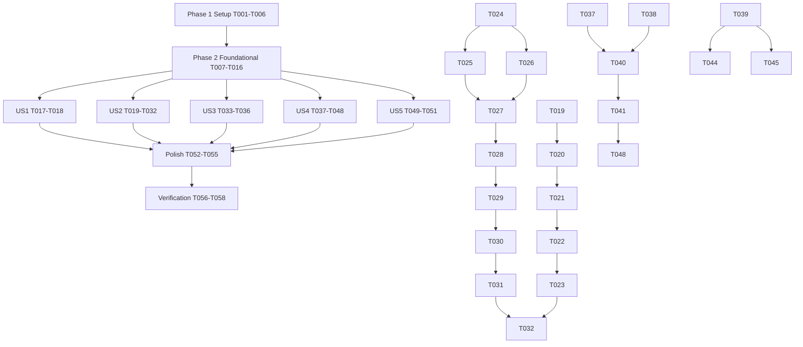

# Tasks: Gecko for HarmonyOS 完整移植工程

**Input**: Design documents from `spec/gecko-porting-program/`
**Prerequisites**: `plan.md`（技术路线与架构）、`spec.md`（需求与用户故事）

**Tests**: 包含必要的冒烟/集成/UI 验证任务；不生成完整 Gecko 测试套件（后续里程碑）。

**Organization**: 按用户故事分组；Setup/Foundational/Polish 不带 `[USx]` 标签。任务描述中的路径均相对于 `PROJECT_ROOT = /storage/Users/currentUser/Documents/DevEcoStudioProjects/firefoxport`。

## Format: `[ID] [P?] [Story] Description`

- **[P]**: 可并行（不同文件、无未完成依赖）
- **[Story]**: 用户故事标签（`US1`-`US5`）
- 每个任务以 `- [ ]` 开头，包含唯一 ID 与精确文件路径

## Path Conventions

- 项目根：`/storage/Users/currentUser/Documents/DevEcoStudioProjects/firefoxport`
- HarmonyOS UI：`entry/src/main/ets/`
- Native 模块：`gecko/src/main/cpp/`、`gecko/src/main/libs/arm64-v8a/`
- Gecko 源码：`third_party/gecko/source/`
- 构建产物：`build/gecko/`
- 规格文档：`spec/gecko-porting-program/`

## Phase 1: Setup (Shared Infrastructure)

**Purpose**: 工具链、模块骨架、目录与构建脚本基础。

- [X] T001 [P] 校验并记录工具链版本（SDK clang 15.0.4、Homebrew clang 22.1.8、Rust 1.99.1、CMake 3.28.2、Ninja 1.13.2、Python 3.12.10、Git 2.56.1）到 `scripts/toolchain-manifest.json`
- [X] T002 创建 `gecko` HSP 模块骨架：`gecko/build-profile.json5`、`gecko/oh-package.json5`、`gecko/hvigorfile.ts`、`gecko/src/main/module.json5`（`type: "shared"`）
- [X] T003 在根 `build-profile.json5` 注册 `gecko` 模块，并在 `entry/oh-package.json5` 增加对 `gecko` 的依赖
- [X] T004 [P] 创建 `third_party/gecko/{source,patches,mozconfig,scripts}` 与 `build/gecko/{obj-aarch64-ohos,artifacts}` 目录，并更新 `.gitignore`
- [X] T005 [P] 创建 `scripts/README.md`，记录构建、产物暂存、签名、部署的统一命令契约
- [X] T006 创建 `gecko/src/main/cpp/CMakeLists.txt`，链接 `libace_napi.z.so` 与 `libhilog_ndk.z.so`

---

## Phase 2: Foundational (Blocking Prerequisites)

**Purpose**: `gecko` HSP、NAPI 桥接、ArkTS facade、XComponent 宿主与产物脚本；阻塞所有用户故事。

**⚠️ CRITICAL**: 本阶段完成前，用户故事任务不应开始。

- [X] T007 创建 NAPI 模块骨架：`gecko/src/main/cpp/include/gecko_napi.h`、`gecko/src/main/cpp/src/gecko_module.cpp`
- [X] T008 配置 `gecko/build-profile.json5` 的 `externalNativeOptions`：CMake 路径、`abiFilters`（`arm64-v8a`）、C++ 编译参数
- [X] T009 创建 ArkTS facade：`gecko/src/main/ets/GeckoEngine.ets`（`getVersion`、`ping`）
- [X] T010 创建 `entry` 服务封装：`entry/src/main/ets/service/GeckoService.ets`
- [X] T011 [P] 创建公共类型与错误码：`entry/src/main/ets/common/GeckoTypes.ets`、`entry/src/main/ets/common/GeckoErrors.ets`
- [X] T012 [P] 创建 XComponent 宿主组件：`entry/src/main/ets/components/GeckoSurface.ets`（SURFACE 类型、生命周期回调占位）
- [X] T013 [P] 创建产物暂存脚本：`scripts/stage_gecko_artifacts.py`（复制 `.so`、生成 `manifest.json`）
- [X] T014 [P] 创建产物校验脚本：`scripts/verify_gecko_bundle.py`（ABI、导出符号、SHA-256）
- [X] T015 [P] 创建 Gecko 构建入口脚本：`scripts/build_gecko.sh`（mach 构建封装契约）
- [X] T016 [P] 创建实施记录：`spec/gecko-porting-program/implementation-notes.md`（构建顺序、门禁检查清单）

**Checkpoint**: `gecko` HSP 可被 `entry` 依赖，NAPI 骨架可编译，产物脚本可执行。

---

## Phase 3: User Story 1 - 立项决策者审阅完整路线 (Priority: P1)

**Goal**: 形成可评审的决策包，回答“做什么、谁来做、多久、成本量级、何时停止”。

**Independent Test**: 审阅 `decision-package.md` 与 `risk-register.md`，确认每个里程碑有目标、交付物、验收标准、依赖、风险与停止条件。

- [X] T017 [P] [US1] 创建 `spec/gecko-porting-program/decision-package.md`（基线、资源档位、里程碑门禁、停止条件）
- [X] T018 [P] [US1] 创建 `spec/gecko-porting-program/risk-register.md`（R1-R13、概率/影响、缓解措施、触发条件）

**Checkpoint**: 决策者可在 30 分钟内完成立项评审并给出 Go/No-Go。

---

## Phase 4: User Story 2 - 平台工程师评估适配边界 (Priority: P1) 🎯 MVP

**Goal**: 打通 HAP + NAPI + Rust/C++ `.so`（M0），并尝试 SpiderMonkey 最小构建与 JS 求值（M1）。

**Independent Test**: 在 MatePad Edge 安装 HAP，ArkTS 调用 NAPI 返回 Rust 计算结果；若 `libmozjs.so` 构建成功，`evaluateScript` 返回预期值；若失败，记录明确阻塞点。

- [X] T019 [P] [US2] 创建 Rust 冒烟 crate：`gecko/rust/ohos-smoke/Cargo.toml`、`gecko/rust/ohos-smoke/src/lib.rs`
- [X] T020 [US2] 创建构建脚本：`scripts/build_rust_smoke.sh`（`cargo build --target aarch64-unknown-linux-ohos`，复制 `.so`）
- [X] T021 [US2] 将 `libohos_smoke.so` 放入 `gecko/src/main/libs/arm64-v8a/`
- [X] T022 [US2] 在 `gecko/src/main/cpp/src/gecko_module.cpp` 绑定 `ohos_rust_add` 并暴露 NAPI 方法
- [X] T023 [US2] 改造 `entry/src/main/ets/pages/Index.ets` 为调试页，显示引擎版本与 Rust 加法结果
- [X] T024 [P] [US2] 创建 `scripts/fetch_gecko.py`（按基线 checkout、应用 `third_party/gecko/patches`）
- [X] T025 [US2] 创建 `third_party/gecko/mozconfig/ohos-aarch64.mozconfig`（clang 22、Rust 1.99、sysroot、`--enable-project=js`）
- [X] T026 [US2] 创建 `third_party/gecko/patches/README.md` 与 `third_party/gecko/patches/0001-ohos-target.patch` 骨架
- [X] T027 [US2] 尝试 SpiderMonkey 最小构建，日志写入 `build/gecko/artifacts/js-build.log`；失败时记录阻塞点
- [ ] T028 [US2] 将 `libmozjs.so` 与头文件暂存到 `build/gecko/artifacts/` 和 `gecko/src/main/libs/arm64-v8a/`
- [X] T029 [US2] 在 `gecko/src/main/cpp/src/gecko_module.cpp` 实现 `evaluateScript`（`libmozjs` 可用时调用，否则返回 `UNSUPPORTED`）
- [X] T030 [US2] 创建 JS 冒烟页：`entry/src/main/ets/pages/JsSmokePage.ets`
- [X] T031 [US2] 创建 `spec/gecko-porting-program/m1-report.md`（构建结果、JS 求值、内存、阻塞点）
- [ ] T032 [US2] 在设备上验证 HAP 加载 `gecko` HSP 并完成 ArkTS→NAPI→Rust 调用，记录到 `spec/gecko-porting-program/m1-report.md`

**Checkpoint**: G0 通过（HAP/NAPI/Rust）；G1 按 `m1-report.md` 判定通过或记录阻塞。

---

## Phase 5: User Story 3 - 安全与合规评审 (Priority: P1)

**Goal**: 明确 JIT、进程、执行策略、应用商店合规路径，给出“可行/不可行/待审批”结论。

**Independent Test**: 审阅 `security-compliance.md`，每条硬约束均有结论、替代方案与风险等级。

- [X] T033 [US3] 创建 `spec/gecko-porting-program/security-compliance.md` 的 JIT 章节（解释器/ACL/坚盾模式）
- [X] T034 [US3] 在 `security-compliance.md` 增加进程模型与 fork/exec/ChildProcess 章节
- [X] T035 [US3] 在 `security-compliance.md` 增加应用商店政策、权限声明与隐私合规清单
- [X] T036 [P] [US3] 审计 `entry/src/main/module.json5` 与 `gecko/src/main/module.json5`，确保未在未获批时声明 JIT ACL 权限

**Checkpoint**: 安全/合规评审可给出 Go/No-Go 或“待审批”结论。

---

## Phase 6: User Story 4 - 产品负责人确认首版范围 (Priority: P2)

**Goal**: 交付浏览器壳 MVP：地址栏、标签页、书签、历史、下载、设置、隐私模式；引擎通过 `GeckoService` stub 接入。

**Independent Test**: 安装 HAP 后完成“输入 URL → 打开标签 → 收藏 → 查看历史 → 下载文件 → 切换隐私模式”的本地流程（引擎未就绪时使用占位页）。

- [X] T037 [P] [US4] 定义领域模型：`entry/src/main/ets/model/BrowserModels.ets`
- [X] T038 [P] [US4] 实现设置仓储：`entry/src/main/ets/data/SettingsRepository.ets`
- [X] T039 [US4] 实现 RelationalStore 数据库：`entry/src/main/ets/data/BrowserDatabase.ets`（profiles/bookmarks/history/downloads/permissions）
- [X] T040 [US4] 实现标签页 ViewModel：`entry/src/main/ets/viewmodel/TabViewModel.ets`
- [X] T041 [US4] 实现浏览器主页面：`entry/src/main/ets/pages/BrowserPage.ets`
- [X] T042 [P] [US4] 实现地址栏组件：`entry/src/main/ets/components/AddressBar.ets`
- [X] T043 [P] [US4] 实现标签栏组件：`entry/src/main/ets/components/TabBar.ets`
- [X] T044 [P] [US4] 实现书签与历史视图：`entry/src/main/ets/views/BookmarksView.ets`、`entry/src/main/ets/views/HistoryView.ets`
- [X] T045 [P] [US4] 实现下载视图：`entry/src/main/ets/views/DownloadsView.ets`
- [X] T046 [P] [US4] 实现设置视图：`entry/src/main/ets/views/SettingsView.ets`
- [X] T047 [US4] 实现本地账户与导入/导出：`entry/src/main/ets/service/LocalAccountService.ets`
- [X] T048 [US4] 将 `GeckoService` stub 接入 `BrowserPage.ets`，并实现隐私模式数据隔离

**Checkpoint**: 浏览器壳 MVP 可独立演示，数据持久化与隐私模式可用。

---

## Phase 7: User Story 5 - 发布经理评估维护成本 (Priority: P3)

**Goal**: 建立补丁队列、rebase 流程与上游维护清单。

**Independent Test**: 按 `upstream-maintenance.md` 执行一次模拟 rebase，确认补丁分类、冲突处理与回归清单可操作。

- [X] T049 [P] [US5] 完善 `third_party/gecko/patches/README.md`（补丁命名、分类、上游链接规范）
- [X] T050 [P] [US5] 创建 `scripts/rebase_gecko.py`（rebase 流程骨架与冲突报告）
- [X] T051 [P] [US5] 创建 `spec/gecko-porting-program/upstream-maintenance.md`（CI、安全响应 SLA、版本节奏）

**Checkpoint**: 维护流程可被发布经理独立复核。

---

## Phase 8: Polish & Cross-Cutting Concerns

**Purpose**: 错误处理、日志、性能基线与文档收尾。

- [X] T052 [P] 统一错误码与日志：`entry/src/main/ets/common/GeckoErrors.ets`、`gecko/src/main/cpp/src/gecko_module.cpp`
- [X] T053 [P] 创建性能基线记录：`spec/gecko-porting-program/performance-baseline.md`
- [X] T054 [P] 更新实施记录与构建说明：`spec/gecko-porting-program/implementation-notes.md`
- [X] T055 [P] 清理构建产物与忽略规则：`.gitignore`、`build/gecko/artifacts/.gitkeep`

---

## Phase 9: Verification

<!-- verification_scope: build+ui -->

**Purpose**: 构建、部署并验证已实现功能。

- [ ] T056 构建项目并修复编译错误（运行 `devecocli build`；迭代 fix → build 直到成功；目标 `entry/build-profile.json5`）
- [ ] T057 部署到设备（运行 `devecocli run --skip-build`；目标 `entry/src/main/module.json5`）
- [ ] T058 运行 UI 验证（调用 `verify_ui`；覆盖 US2 NAPI/Rust 冒烟与 US4 浏览器壳核心流程；目标 `entry/src/main/ets/pages/BrowserPage.ets`）

---

## Dependencies & Execution Order

### Phase Dependencies

- **Setup (Phase 1)**: 无依赖，可立即开始。
- **Foundational (Phase 2)**: 依赖 Setup；完成前不得开始用户故事。
- **US1/US2/US3 (P1)**: 依赖 Foundational；可并行或按优先级串行。
- **US4 (P2)**: 依赖 Foundational；可在 US2 的 NAPI 骨架完成后并行。
- **US5 (P3)**: 依赖 US2 的 Gecko 源码/补丁目录。
- **Polish**: 依赖目标用户故事完成。
- **Verification**: 依赖 Polish 与所有计划内实现任务。

### Within Each User Story

- 模型 → 仓储/服务 → ViewModel → UI → 集成。
- US2：Rust crate → NAPI 绑定 → HAP 验证 → SpiderMonkey 构建 → JS 求值。
- US4：模型 → 数据层 → ViewModel → 页面/组件 → 服务接入。

### Parallel Opportunities

- Setup 中 T004/T005 可并行；T001 可与 T002/T004 并行。
- Foundational 中 T011-T016 可并行；T007/T009/T010 为串行链。
- US1 的 T017/T018 可并行；US3 的 T036 可与 T033-T035 并行。
- US4 的 T037/T038/T042/T043/T044/T045/T046 可并行；T039/T040/T041/T048 为串行链。
- US5 的 T049-T051 可并行。

---

## 📊 Dependency Graph



---

## ⚡ Parallel Execution Guide

| Phase | Tasks | Required Files | Execution Notes |
|---|---|---|---|
| Setup | T001, T004, T005 | `scripts/toolchain-manifest.json`, `third_party/gecko/`, `scripts/README.md` | 目录/清单类任务互不冲突，可并行 |
| Foundational | T011, T012, T013, T014, T015, T016 | `entry/src/main/ets/common/`, `entry/src/main/ets/components/`, `scripts/` | 不同文件；NAPI 主链 T007→T009→T010 仍串行 |
| US1 | T017, T018 | `spec/gecko-porting-program/decision-package.md`, `risk-register.md` | 两个文档可并行撰写 |
| US2 | T019, T024 | `gecko/rust/ohos-smoke/`, `scripts/fetch_gecko.py` | Rust 冒烟与源码拉取可并行；后续构建链串行 |
| US3 | T036 | `entry/src/main/module.json5`, `gecko/src/main/module.json5` | 权限审计可与文档撰写并行 |
| US4 | T037, T038, T042, T043, T044, T045, T046 | `entry/src/main/ets/model/`, `data/`, `components/`, `views/` | 不同文件；T040/T041/T048 依赖前置模型与数据层 |
| US5 | T049, T050, T051 | `third_party/gecko/patches/README.md`, `scripts/rebase_gecko.py`, `spec/.../upstream-maintenance.md` | 三个文件互不冲突 |
| Polish | T052, T053, T054, T055 | `entry/src/main/ets/common/`, `spec/...`, `.gitignore` | 可并行 |
| Verification | T056 → T057 → T058 | `entry/build-profile.json5`, `entry/src/main/module.json5`, `entry/src/main/ets/pages/BrowserPage.ets` | 必须串行：构建成功后才能部署与 UI 验证 |

---

## Parallel Example

```text
# US2 并行起点
T019 Rust 冒烟 crate 与 T024 Gecko 源码拉取可并行

# US4 并行
T042 地址栏、T043 标签栏、T044 书签/历史、T045 下载、T046 设置可并行
```

## Implementation Strategy

### MVP First (US2 M0)

1. 完成 Setup + Foundational。
2. 完成 US2 的 T019-T023：HAP + NAPI + Rust `.so` 冒烟。
3. **STOP and VALIDATE**：设备安装、ArkTS→NAPI→Rust 调用成功（G0）。
4. 再进入 T024-T032：SpiderMonkey 最小构建与 JS 求值（G1）。

### Incremental Delivery

1. Foundation ready → `gecko` HSP + NAPI 骨架。
2. US2 M0 → 可运行的原生调用 Demo。
3. US2 M1 → JS 求值能力或明确阻塞报告。
4. US4 → 浏览器壳 MVP（stub 引擎）可演示。
5. US1/US3/US5 → 决策、合规、维护文档并行收口。

### Future Gated Backlog (M2-M7)

以下里程碑**不在本轮 Phase 4 执行范围内**，需通过前置门禁后另立任务：

| 里程碑 | 内容 | 进入条件 |
|---|---|---|
| M2 | Headless Gecko 静态页加载 | G1 通过 |
| M3 | XComponent + GLES/SWGL 屏幕渲染 | G2 通过 |
| M4 | Necko 网络与基础浏览 | G3 通过 |
| M5 | 多标签/书签/历史/下载完整化 | G4 通过 |
| M6 | 性能、安全、媒体、无障碍、上架 | G5 通过 |
| M7 | Firefox Sync（application-services） | M5 完成且同步 spike 通过 |

---

## Notes

- `[P]` 表示不同文件、无未完成依赖，可并行。
- `[USx]` 仅用于用户故事阶段；Setup/Foundational/Polish/Verification 不带故事标签。
- 每个检查点应独立验证；US2 的 G0/G1 是后续 M2 的硬门禁。
- 不把 Gecko 全量源码放入 `entry/src/main/cpp`；源码只在 `third_party/gecko/source`。
- 不在未获 ACL 批准时声明 `ohos.permission.kernel.ALLOW_EXECUTABLE_FORT_MEMORY`，否则安装失败。
- 所有 Native 代码以 HAP/HSP 内嵌 `.so` 形式运行，不依赖独立二进制。

### Summary Report

- **Total tasks**: 58
- **Per phase**: Setup 6；Foundational 10；US1 2；US2 14；US3 4；US4 12；US5 3；Polish 4；Verification 3
- **Parallel opportunities**: Setup 3；Foundational 6；US1 2；US2 2 条并行起点；US3 1；US4 7；US5 3；Polish 4
- **Independent test criteria**:
  - US1：决策包可在 30 分钟内完成评审并给出 Go/No-Go。
  - US2：设备安装 HAP；ArkTS→NAPI→Rust 调用成功；JS 求值或明确阻塞报告。
  - US3：JIT/进程/商店合规均有结论与替代方案。
  - US4：地址栏/标签/书签/历史/下载/隐私模式核心流程可演示。
  - US5：模拟 rebase 可执行，补丁分类与回归清单完整。
- **Suggested MVP scope**: Setup + Foundational + US2（T001-T032）→ G0/G1。
- **Verification scope**: `build+ui`（构建 + 部署 + UI 验证）。
